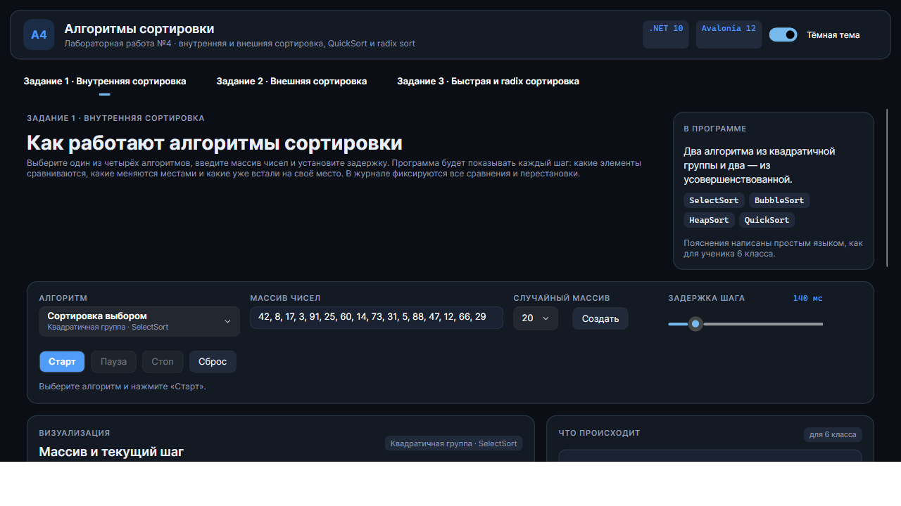
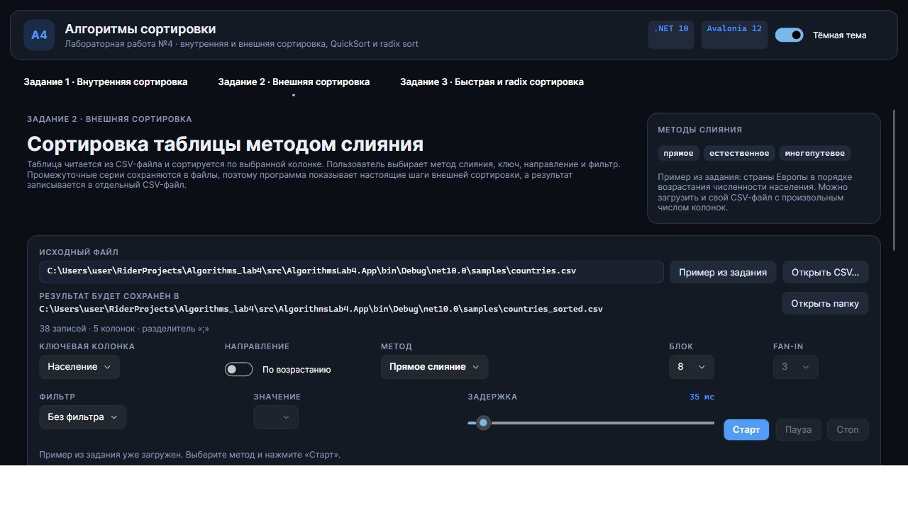
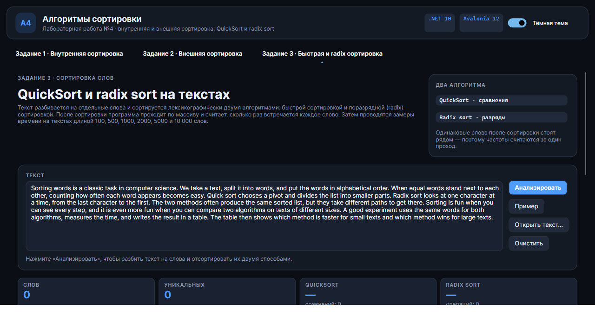

# Лабораторная работа №4 — алгоритмы сортировки

Приложение на **C# / .NET 10** с графическим интерфейсом на **Avalonia 12**.
В одной программе собраны все три задания: внутренняя сортировка, внешняя
сортировка CSV-таблицы и сравнение QuickSort с поразрядной (radix) сортировкой
слов.



---

## Как запустить

Нужен [.NET 10 SDK](https://dotnet.microsoft.com/download) (проект использует
`net10.0`) и Windows, Linux или macOS с графической средой.

```bash
cd Algorithms_lab4
dotnet run --project src/AlgorithmsLab4.App
```

Сборка всего решения:

```bash
dotnet build Algorithms_lab4.sln
```

Запуск тестов:

```bash
dotnet test Algorithms_lab4.sln
```

> В некоторых ограниченных средах `dotnet test` не может создать именованный
> канал. Тесты при этом можно запустить напрямую:
> `tests/AlgorithmsLab4.Tests/bin/Debug/net10.0/AlgorithmsLab4.Tests.exe`.
> В обычной системе команда `dotnet test` работает штатно.

---

## Задание 1. Внутренняя сортировка

Реализованы четыре алгоритма — по два из каждой группы:

| Группа | Алгоритм | Сложность |
|---|---|---|
| Квадратичная | Сортировка выбором (SelectSort) | O(n²) сравнений, O(1) памяти |
| Квадратичная | Сортировка пузырьком с улучшениями (BubbleSort) | O(n²), в лучшем случае O(n) |
| Усовершенствованная | Пирамидальная сортировка (HeapSort) | O(n log n) в любом случае |
| Усовершенствованная | Быстрая сортировка Хоара (QuickSort) | в среднем O(n log n), в худшем O(n²) |

Что умеет вкладка:

- массив вводится вручную или генерируется случайно (3–64 числа);
- пользователь задаёт задержку между шагами (0–1000 мс), может поставить паузу,
  продолжить или остановить сортировку;
- каждый шаг показывается на столбчатой диаграмме: сравниваемые элементы
  подсвечиваются жёлтым, переставляемые — красным, опорный элемент QuickSort —
  фиолетовым, готовые элементы — зелёным;
- под диаграммой выводится пояснение «для шестиклассника»;
- журнал фиксирует **все** сравнения и перестановки с номерами шагов.

Алгоритмы реализованы в виде итераторов (`IEnumerable<SortEvent>`): на каждом
шаге отдаётся снимок массива и индексы, которые нужно подсветить. Благодаря
этому интерфейс не знает о внутреннем устройстве алгоритмов, а журнал и
визуализация строятся по одним и тем же событиям.

Основной код: `src/AlgorithmsLab4.Core/Sorting/SortRunner.cs`.

---

## Задание 2. Внешняя сортировка таблицы



Таблица читается из CSV-файла с произвольным числом колонок. Пользователь
выбирает:

- ключевую колонку (сравнение чисел и строк определяется автоматически);
- направление сортировки;
- метод внешней сортировки;
- размер блока, который сортируется в памяти;
- при необходимости — колонку и значение фильтра.

Реализованы все три метода:

1. **Прямое слияние** — входной файл разбивается на блоки фиксированного
   размера, каждый блок сортируется в памяти и сохраняется во временный файл,
   затем серии попарно сливаются.
2. **Естественное слияние** — из входного файла выделяются уже упорядоченные
   серии; если данные почти отсортированы, серий получается мало.
3. **Многопутевое слияние** — за один проход сливаются сразу `fan-in` серий,
   что уменьшает число проходов по файлам.

Сортировка действительно внешняя: входной файл читается потоково, серии
хранятся в отдельных временных файлах, результат записывается в новый CSV.
Временные файлы удаляются после завершения или остановки. Каталог для них
выбирается автоматически: `%LOCALAPPDATA%\AlgorithmsLab4\temp`, затем папка
программы, затем системный временный каталог.

Интерфейс показывает исходную и отсортированную таблицы, счётчики сравнений,
перемещений, созданных серий и проходов слияния, а также журнал шагов. Задержка
между шагами настраивается, сортировку можно приостановить и остановить.

Демонстрационный пример — таблица стран (название, континент, столица, площадь,
население). Кнопка «Пример из задания» загружает её и настраивает сортировку
стран Европы по возрастанию населения. Можно открыть и любой свой CSV-файл.

Основной код: `src/AlgorithmsLab4.Core/ExternalSort/`.

---

## Задание 3. QuickSort и radix sort для слов



Текст разбивается на слова (поддерживаются русские и английские буквы, цифры,
дефис и апостроф; регистр приводится к нижнему). Полученный массив сортируется
двумя способами:

- **QuickSort** — трёхпутевая схема: массив делится на части «меньше», «равно»
  и «больше» опорного элемента. Повторяющиеся слова обрабатываются за один
  проход, что удобно для текстов.
- **Radix sort** — LSD-сортировка строк: слова выравниваются по длине и
  стабильно сортируются по символам справа налево. Слова целиком не
  сравниваются — за один раз учитывается один символ.

После сортировки массив просматривается один раз: одинаковые слова стоят
рядом, поэтому частота каждого слова подсчитывается без словаря и хеширования.
На экран выводятся отсортированные слова и таблица частот с наглядными
полосками. Строка состояния показывает, совпали ли результаты двух алгоритмов.

### Эксперименты

Кнопка «Запустить эксперименты» строит тексты длиной 100, 500, 1000, 2000,
5000 и 10 000 слов и замеряет время обоих алгоритмов. Для устойчивости каждое
измерение повторяется 3 раза и в таблицу попадает лучшее время. Результаты
можно сохранить в CSV.

Пример результатов (Release, 5 повторов, встроенный английский корпус;
конкретные числа зависят от компьютера):

| Слов | QuickSort, мс | Radix sort, мс | Сравнений QuickSort | Операций Radix | Уникальных | Совпали |
|-----:|--------------:|---------------:|--------------------:|---------------:|-----------:|:-------:|
| 100 | 0,008 | 0,364 | 762 | 900 | 70 | да |
| 500 | 0,056 | 0,372 | 4246 | 4500 | 156 | да |
| 1000 | 0,122 | 0,360 | 8548 | 9000 | 177 | да |
| 2000 | 0,213 | 0,387 | 15 602 | 18 000 | 180 | да |
| 5000 | 0,409 | 0,487 | 37 765 | 45 000 | 180 | да |
| 10 000 | 0,706 | 0,655 | 75 098 | 90 000 | 180 | да |

Выводы:

- на коротких текстах QuickSort быстрее: radix sort тратит время на подготовку
  разрядов и дополнительный буфер;
- с ростом длины radix sort становится конкурентоспособным и на 10 000 слов
  обгоняет QuickSort;
- число сравнений QuickSort растёт как `n log n`, а число операций radix
  линейно зависит от длины слов и количества разрядов;
- оба алгоритма дают одинаковый лексикографический порядок, что подтверждается
  столбцом «Совпали».

Основной код: `src/AlgorithmsLab4.Core/Words/`.

---

## Структура решения

```
Algorithms_lab4.sln
├── src
│   ├── AlgorithmsLab4.Core          — алгоритмы без привязки к интерфейсу
│   │   ├── Sorting                 — четыре алгоритма задания 1
│   │   ├── ExternalSort            — CSV, серии, три метода слияния
│   │   ├── Words                   — токенизация, QuickSort, radix, частоты
│   │   └── SampleData.cs           — демонстрационная таблица стран
│   └── AlgorithmsLab4.App          — Avalonia-приложение
│       ├── ViewModels              — логика трёх вкладок
│       ├── Views                   — XAML-разметка
│       └── Styles                  — общая тема и стили
├── tests
│   └── AlgorithmsLab4.Tests        — xUnit-тесты (19 тестов)
└── docs/screenshots                — снимки экрана для отчёта
```

Проект собирается с `TreatWarningsAsErrors`, поэтому код должен оставаться без
предупреждений компилятора и анализаторов.

---

## Тесты

xUnit-тесты проверяют:

- корректность всех четырёх алгоритмов на разных наборах (пустой массив,
  один элемент, повторы, уже отсортированный и обратный порядок);
- соответствие журнала событий фактическим сравнениям и перестановкам;
- равенство результатов QuickSort и radix sort;
- токенизацию текста, включая знаки препинания и регистр;
- подсчёт частот;
- чтение и запись CSV с кавычками, разделителями и переводами строк;
- все три метода внешней сортировки, фильтрацию, сортировку по убыванию и
  пустой результат фильтра;
- согласованность таблицы экспериментов с результатами отдельных запусков.

Запуск: `dotnet test Algorithms_lab4.sln`.

---

## Обозначения в интерфейсе

- **Задержка шага** — пауза между визуальными шагами; `0` означает максимальную
  скорость без искусственных задержек.
- **Пауза / Продолжить** — приостанавливает показ, не прерывая алгоритм.
- **Стоп** — отменяет сортировку; временные файлы удаляются, итоговый файл не
  изменяется.
- **Блок** — количество записей, сортируемых в памяти за один раз (задание 2).
- **Fan-in** — сколько серий сливается за один проход многопутевого слияния.
- **Журнал** — все сравнения и перемещения с пояснениями; прокручивается
  автоматически.

Тема оформления переключается в правом верхнем углу (тёмная / светлая).
